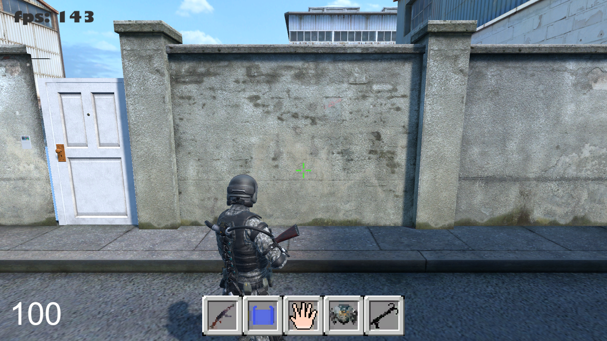
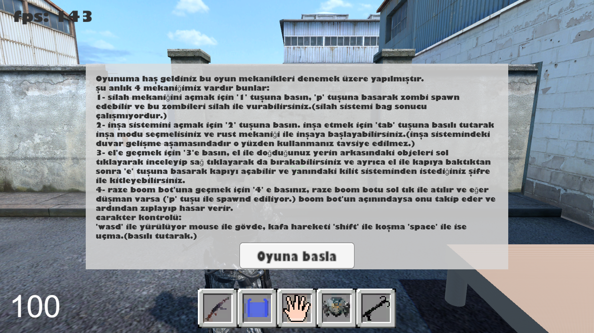

# 🪖 Outpost: FPS Survival Sandbox

**Bir hayatta kalma oyununun temel mekaniklerini tek bir sandbox içinde denediğim Unity prototipi: silah ve zombiler, Rust tarzı inşa, obje etkileşimi, şifreli kapı, araca binme ve Valorant'tan esinlenen bir yetenek.**

## Mekanikler
Her mekanik, alttaki envanter çubuğundan (1–5) seçilen ayrı bir araçla açılır:

| Tuş | Mekanik | Nasıl çalışır |
|---|---|---|
| `1` | **Silah ve zombiler** | `P` ile zombi doğurulur. Zombiler NavMesh ile oyuncuyu kovalar ve saldırır; silahla vurulabilir. |
| `2` | **Rust tarzı inşa** | `Tab` basılıyken temel ya da duvar seçilir. Yarı saydam önizleme, nişan alınan noktaya veya mevcut parçanın **bağlantı soketine** yapışır; tıklayınca parça yerleştirilir. |
| `3` | **El ile etkileşim** | Objelere bakıp sol tıkla alınır, incelenir, sağ tıkla bırakılır. `E` ile kapı açılır; kapının yanındaki **şifreli kilit** istenen şifreyle kilitlenip açılabilir. |
| `4` | **Boom bot** | Atıldığı yönde ilerler, menzildeki düşmanı görürse takip eder ve sıçrayıp hasar verir (Valorant'taki Raze yeteneğinden esinlenildi). |
| — | **Araca binme** | Araca yaklaşıp binilir; ayrı araç fiziği ve kamera kontrolü vardır. |

**Karakter kontrolü:** `WASD` ile yürüme, fareyle gövde ve kafa hareketi, `Shift` ile koşma, `Space` basılı tutularak uçma.

## Nasıl denenir
[Releases](../../releases) sayfasından `Outpost-Windows.zip` dosyasını indirip `Outpost.exe` ile başlat ve **Oyuna başla**'ya tıkla.

## Kod
Tüm oynanış scriptleri [`showcase/Scripts`](showcase/Scripts) klasöründedir:
- `rust_build/build_controler.cs`: inşa sistemi,
- `kapi/sifreli_kilit.cs`: şifreli kilit,
- `valorant_skil/raze_boom_bot.cs`: boom bot,
- `fps oyunu/dusman_controler.cs`: zombi davranışı (NavMesh takip ve saldırı),
- `player_controler/`: karakter, araca binme ve obje etkileşimi.

---
© Ahmet Emin Arslanbaş — Tüm hakları saklıdır. 3B modeller ve dokular ilgili sahiplerinin lisanslarına tabidir.
